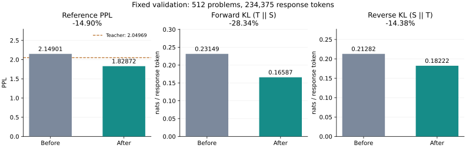

# 数学 TRD 蒸馏前后 PPL / KLD 对比与初步分析

日期：2026-11-16。范围：已完成的单次训练与固定验证集评分；本次仅复核既有结果、制作报告，没有重新运行模型。

**本轮蒸馏在固定留出验证分布上取得了明确改善：学生 PPL 下降14.90%，前向KL下降28.34%，反向KL下降14.38%。这支持“参考解答预测改善、在参考前缀上更接近固定教师”的判断。改善并不均匀，短参考解答的反向KL出现上升；这些指标本身不能证明数学答题正确率或整体能力超过教师。**

## 1. 对比对象与可比性

| 项目 | 本次设置 |
| --- | --- |
| 蒸馏前学生 S0 | Qwen3-4B-Instruct-2507 原始公开权重 |
| 蒸馏后学生 S1 | 9,984题训练、1 epoch、78次更新后的HF合并模型 |
| 固定教师 T | Qwen3-8B，训练及本轮对比均不更新教师 |
| 训练目标与适配 | TRD `forward_kl_y_r`，全词表前向KL；LoRA rank64/alpha128、学习率5e-6 |
| 验证数据 | 固定512题：易69／中331／难112，均有非空且终答自动判等通过的参考解答 |
| 计分规模 | 234,375个有效response tokens；均值457.76、最长1,674 tokens |
| 输入 | 相同题目、指令与同一份参考解答前缀；只统计response，不统计prompt/padding |
| KL与数值口径 | 温度1、自然对数、全词表、不裁剪/不取top-k；FP32概率运算、FP64累计 |
| 聚合 | 先加总逐题NLL/KL分子及token数，再取token加权平均；PPL=exp(NLL) |

本次检查了两份逐题结果文件SHA256，独立汇总后的全局及各分桶数值与原summary一致；512个sample ID、raw ID、题组、前缀token哈希、有效token数及分层标签均逐题配对一致。两次评分的协议哈希相同，保存的教师权重内容哈希也相同。教师总体NLL/PPL完全相同，逐题教师NLL总和最大数值差仅约4.55e-13，与浮点归约误差相符。

验证题及其既有重复组按冻结划分排除在本次训练池之外；“留出”指本次蒸馏与训练生成的隔离，不保证这些题目从未出现在原模型预训练中。划分细节见[数据工程报告](../../data_engineering/REPORT.zh-CN.md)。

## 2. 总体指标

绝对变化为“蒸馏后−蒸馏前”，相对变化为该差值除以蒸馏前值；负数表示下降。PPL无量纲，NLL和KL使用nats/有效response token。

| 指标 | 蒸馏前 | 蒸馏后 | 绝对变化 | 相对变化 |
| --- | ---: | ---: | ---: | ---: |
| 学生 PPL | 2.149008 | 1.828723 | -0.320285 | -14.90% |
| 学生 NLL（nats/token） | 0.765006 | 0.603618 | -0.161388 | -21.10% |
| 前向 KL(T‖S)（nats/token） | 0.231488 | 0.165873 | -0.065614 | -28.34% |
| 反向 KL(S‖T)（nats/token） | 0.212816 | 0.182217 | -0.030599 | -14.38% |
| 教师 PPL（控制项） | 2.049692 | 2.049692 | +0.000000 | +0.00% |
| 教师 NLL（控制项） | 0.717689 | 0.717689 | +0.000000 | +0.00% |

PPL与NLL是同一组预测概率的两种表达，不能把它们当作两份独立的学习证据。PPL从2.149008降到1.828723，表示模型对这份留出参考解答的预测改善；等价地，参考token概率的几何平均值提高约17.51%。该比例不等于答题正确率的提升。

前向与反向KL同时下降，说明沿本次固定参考前缀，师生全词表分布在两个加权方向上都整体接近了。前向KL降幅更大，与本轮采用前向KL训练目标的设定一致；当前没有训练方向的对照实验，不能据此作单一机制归因。

## 3. 配对置信区间

直接采用蒸馏后评分已生成的1,000次按题配对bootstrap，seed=20261115。每次将同一题的前后记录一起重采样，重新汇总NLL/KL分子与token分母，再计算PPL或均值；没有把23万token当作独立样本。

| 指标 | 蒸馏后−蒸馏前 | 差值的95%区间 |
| --- | ---: | --- |
| student_ppl | -0.320285 | [-0.343688, -0.299250] |
| student_nll | -0.161388 | [-0.168933, -0.154120] |
| forward_kl | -0.065614 | [-0.070461, -0.061122] |
| reverse_kl | -0.030599 | [-0.034809, -0.026472] |

上述区间均位于0以下，表明在这份固定验证样本的题目重采样下，总体下降较稳定。区间描述的是验证题目抽样波动，不包含重新训练的随机种子差异、清洗/标签偏差或预训练重叠等系统因素；这里只有一次正式训练，不能声称多次训练均可复现相同收益。

## 4. 改善是否覆盖多数题目

下表对每题分别计算平均NLL/KL再比较方向。由于同一题前后有效token数相同，逐题NLL下降也意味着逐题PPL下降。这与总体表的token加权数值是不同视角。

| 指标 | 下降题数 | 上升题数 | 不变题数 |
| --- | ---: | ---: | ---: |
| 学生 NLL / PPL | 512（100.00%） | 0（0.00%） | 0 |
| 前向 KL | 496（96.88%） | 16（3.12%） | 0 |
| 反向 KL | 344（67.19%） | 168（32.81%） | 0 |

参考解答NLL/PPL在512题中全部改善，前向KL也在496题改善，说明结果并非只由少量高权重题目带动。但是反向KL有168题上升，占32.81%；整体均值下降不等于每道题、每个前缀都更接近教师。这里没有将“每题指标改善”解释为“该题自由生成变正确”。

## 5. 难度、领域与长度

### 5.1 难度分组

| 难度 | 题数 | 学生PPL：前→后 | PPL变化 | 前向KL：前→后 | 前向KL变化 | 反向KL变化 |
| --- | ---: | --- | ---: | --- | ---: | ---: |
| 易 | 69 | 1.7595 → 1.4971 | -14.92% | 0.2012 → 0.1188 | -40.94% | -20.83% |
| 中 | 331 | 1.9759 → 1.7056 | -13.68% | 0.1955 → 0.1391 | -28.84% | -14.80% |
| 难 | 112 | 2.9935 → 2.4475 | -18.24% | 0.3468 → 0.2635 | -24.03% | -11.72% |

易、中、难三个分组的PPL及两个方向KL均下降。难题的PPL相对降幅最大，为18.24%；容易题的前向KL相对降幅最大，为40.94%。两者衡量不同对象，不应混为同一个“收益大小”。蒸馏后难题仍有最高的PPL（2.4475）及KL（前向0.2635／反向0.2585），可作为后续误差分析的重点。这里的难度是数据工程阶段的分层标签，并非经此次模型解题成功率重新定义。

### 5.2 领域分组

| 领域 | 题数 | PPL变化 | 前向KL变化 | 反向KL变化 |
| --- | ---: | ---: | ---: | ---: |
| 代数 | 205 | -15.03% | -30.59% | -15.44% |
| 几何 | 131 | -13.20% | -24.36% | -11.28% |
| 组合/概率 | 99 | -16.66% | -26.54% | -14.48% |
| 数论 | 69 | -14.66% | -30.36% | -15.91% |
| 微积分 | 5 | -18.04% | -36.56% | -21.39% |
| 其他 | 3 | -29.24% | -37.27% | -27.27% |

代数、几何、组合/概率和数论四个主要领域均改善。微积分仅5题，“其他”仅3题，比例可作为描述记录，不据此判断这些领域的稳定收益或跨领域能力排序。

### 5.3 参考解答长度分组

长度指固定参考解答的token数，不是模型自由生成的长度。

| 参考长度 | 题数 | PPL变化 | 前向KL变化 | 反向KL：前→后 | 反向KL变化 |
| --- | ---: | ---: | ---: | --- | ---: |
| <=256 | 111 | -15.58% | -13.90% | 0.345987 → 0.360546 | +4.21% |
| 257-512 | 203 | -14.83% | -29.25% | 0.223964 → 0.194864 | -12.99% |
| 513-1024 | 195 | -14.84% | -31.71% | 0.185569 → 0.147274 | -20.64% |
| >1024 | 3 | -14.88% | -23.49% | 0.212051 → 0.175273 | -17.34% |

**需要保留的反例：≤256 tokens的111题，反向KL从0.345987升至0.360546，增加4.21%，同时PPL和前向KL仍下降。**这说明更好地预测参考token、改善教师加权的前向KL，并不要求所有学生加权的反向KL分组同时下降。该分组结论目前是探索性描述，没有另做分组置信区间或逐token归因；应优先检查这个分组与168道反向KL上升题的交集、具体高损失位置和学生/教师概率。

此外，验证参考最长1,674 tokens，>1,024 tokens的只有3题。这份验证集可以评价较短参考解答上的预测和分布匹配，不能据此推断8K/16K长推理、长程反思或输出多样性的变化。

## 6. 为什么学生PPL能低于教师

蒸馏后学生PPL=1.828723，低于固定教师的2.049692，在这份参考解答上的数值约低10.78%。这与仍为正的KL并不矛盾：

- PPL读取参考文本中实际token的概率；KL比较整个词表的概率分布。
- 学生可以对这份参考文本赋予更高概率，同时与教师保留其他词的概率分配差异。
- 教师PPL不是学生PPL的理论下界，也不是数学正确率的排名。

因此，当前可以说“蒸馏后学生对这份验证参考解答的PPL更低”；不能据此说“4B整体能力超过8B教师”。更高的参考似然也不自动意味着更好的概率校准，当前没有测熵、校准误差或自由生成覆盖率来支持这些延伸判断。

## 7. 结论的适用范围与下一步

本次结果支持：本轮TRD训练改善了本次留出数学参考解答的预测，并降低了固定参考前缀上的教师—学生分布差异。这是回答“模型有没有学到”的一项直接、可复核的证据。

结论限定在“有非空参考解答、终答通过自动一致性检查”的512题子集；最终答案可判等不证明参考推理每一步正确。当前也没有比较训练集和验证集的同口径前后差距，因此仅凭本表不能断言完全没有过拟合。

本轮评价时教师和学生使用相同输入；TRD训练时教师额外看到初始解答与修订指令。因此本报告的KL不应与训练日志中的跨条件KL直接拼接为同一条曲线，也不是蒸馏后模型实时on-policy或完整序列分布的KL。

建议按成本顺序继续：先核查反向KL上升的题目及短解答分组；结合相同采样协议下的原始学生/蒸馏后AIME正确率对比，检验生成能力是否改善；若继续扩大训练，再固定保留当前512题并在多个checkpoint上跟踪同口径指标。不要用当前PPL降幅代替准确率增幅。

复盘或面试时可以表述为：

> 我们在本次蒸馏未训练的固定512道数学验证题上，用相同参考解答进行teacher-forcing对比。蒸馏后PPL下降14.9%，师生前向KL下降28.3%、反向KL下降14.4%，按题配对bootstrap的95%差值区间均低于0。这说明参考预测和固定前缀上的教师分布匹配都有改善；数学正确率则由独立的同口径生成测试评价。

## 8. 证据、产物与耗时

- [蒸馏前SwanLab](https://swanlab.cn/@WangZIyu/trd-math-opd/runs/348lb6qg)；[蒸馏后SwanLab](https://swanlab.cn/@WangZIyu/trd-math-opd/runs/iiroiywf)；[训练SwanLab](https://swanlab.cn/@WangZIyu/trd-math-opd/runs/mym7h666)；[本次结果复核与报告SwanLab](https://swanlab.cn/@WangZIyu/trd-math-opd/runs/qqo1vjmx)。
- 原始汇总：[基线summary](../../logs/ppl-kld/baseline-20261115-101823-758028-27412/summary.json)、[蒸馏后summary](../../logs/ppl-kld/distilled-20261116-031913-959867-152167/summary.json)。逐题统计位于同目录`per-sample.jsonl`，不复制进Git或上传题目文本。
- 本报告的[数值摘要](20261116-comparison.json)、[CSV表格](20261116-comparison.csv)、[SVG图](20261116-comparison.svg)；评分公式及实现见[scoring.py](../scoring.py)。
- 基线端到端耗时62.87秒，蒸馏后88.91秒；两轮每卡纯评分约15–16秒、PyTorch allocated峰值约24.59GiB。端到端包含权重哈希、加载、SwanLab等开销，不能用总耗时差推断模型推理变慢，也没有做独立性能基准。
- 验证parquet SHA256：`e3bca204b91dd7012d45334335553c78b915d3edca33ecd1190bc96cb0ed05d0`。
- 评分协议 SHA256：`0415b94470c60dc9e88677ecf9dbf08830b42033bfb404d88c660b271c5a60c4`。
- 源summary SHA256：基线`4c587257867dd1998b776fe2f9e5592da392ece134da09e354e836f8674b0dec`；蒸馏后`a6d6a2fc2f2670d7f3fc8675f86a39f606b3860e380748e01888d68f0d1f521b`。

本报告只使用已完成实验的记录和CPU统计/作图，无新模型推理；保留原实验summary与REPORT，不覆盖既有结果。
