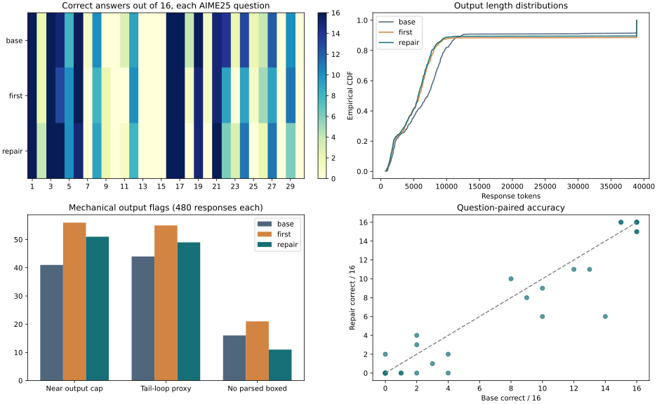
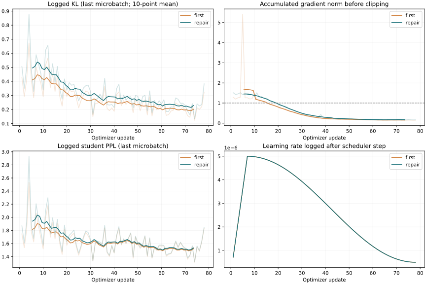
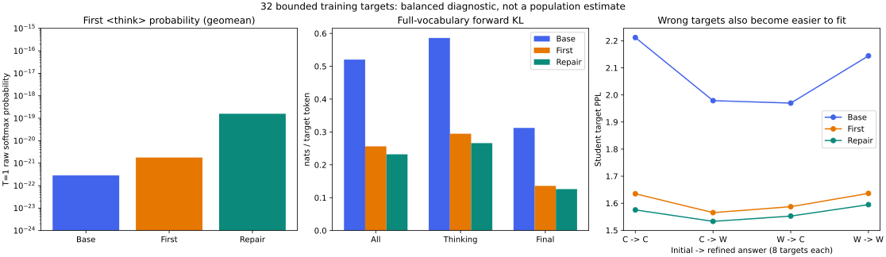

# 数学蒸馏退化诊断：输出、训练指标与冻结前向校验

日期：2026-11-16。范围：原始4B、首轮蒸馏、聊天格式修复蒸馏三组的**既有AIME25输出**，两轮训练日志，固定512题验证，以及32条既有训练目标的冻结前向校验。本次没有新训练、没有重新采集轨迹、没有生成新的AIME回答，也没有运行AIME24。

**核心判断：模型确实学到了降低教师分布差异和参考文本困惑度的能力，但目前的监督包含学生实际几乎不会进入的思考前缀、改写过程，以及答案错误的目标；这些目标上的进步没有转化成独立解题进步。** 格式与结束监督存在实际问题，修复改善了部分输出行为，但未恢复数学正确率。现有证据不能把全部下降归因于某一个因素，更不能据此认定梯度爆炸、过拟合或训练步数不够。

## 1. 下降是否真实，修复是否有效

三组均为同一AIME25文件、同样的30题，每题16次采样，温度0.6、top_p=0.95、TP=2，评分器一致。本次对1440条保存回答重新评分，逐组核对已发布summary，并检查30题提示与标准答案匹配。

| 模型 | 正确回答/480（Avg@16） | 至少一次正确/30（Pass@16） | 前8次至少一次正确（Pass@8） |
| --- | ---: | ---: | ---: |
| 原始4B | 221，46.04% | 23，76.67% | 66.67% |
| 首轮蒸馏 | 201，41.88% | 21，70.00% | 60.00% |
| 格式修复蒸馏 | 199，41.46% | 20，66.67% | 66.67% |

修复后相对原始模型，平均正确率下降4.58个百分点，覆盖少3题；相对首轮，平均正确率低0.42个百分点，仅少2条正确回答。不能把后一个差别解释成“格式修复造成了稳定的进一步退化”。

以**题目为配对单位**，保留每题16条回答整体，进行20,000次bootstrap：

| 比较 | Avg@16变化 | 95%题目bootstrap区间 | 正确次数增加/减少/不变的题数 |
| --- | ---: | ---: | ---: |
| 原始→首轮 | -4.17个百分点 | [-7.92，-0.63] | 5 / 11 / 14 |
| 原始→修复 | -4.58个百分点 | [-9.38，-0.42] | 6 / 14 / 10 |
| 首轮→修复 | -0.42个百分点 | [-4.17，+3.33] | 8 / 8 / 14 |

这些是探索性的单次运行结果；30题较少，没有独立训练种子和生成种子重复。覆盖率的精确McNemar检验p值分别为0.625、0.375、1.0，证据较弱。原始/首轮在AIME24之后生成AIME25，修复组直接先生成AIME25，随机数流不同，**不能把不同模型的第j条回答当成同一个随机试验来配对**。以上分析按题配对，未把480条回答视作480道独立题目。

按原始模型成功次数分组，观察下降的位置：

| 原始成功次数/16 | 题数 | 原始正确回答 | 首轮正确回答 | 修复正确回答 |
| --- | ---: | ---: | ---: | ---: |
| 0次 | 7 | 0/112 | 2/112 | 2/112 |
| 1–8次 | 9 | 27/144 | 20/144 | 20/144 |
| 9–15次 | 8 | 98/128 | 84/128 | 83/128 |
| 16次 | 6 | 96/96 | 95/96 | 94/96 |

主要损失发生在原来部分会做的题；最容易的一组基本保留，原来完全不会的一组只新增覆盖1题。按基线结果分桶存在回归均值效应，不能单独作为遗忘的因果证明，但它定位了需要看哪些输出。

## 2. 训练指标说明了什么

两轮都完成78个优化器更新，9,984题、有效batch=128、1 epoch，LoRA rank=64/alpha=128，学习率峰值5e-6；7步warmup后余弦下降至5e-7。下面是前10步/第35–44步/末10步的日志均值。

| 训练记录 | 阶段 | KL | 学生PPL | 教师PPL | 累积梯度范数（裁剪前） |
| --- | --- | ---: | ---: | ---: | ---: |
| 首轮 | 前10步 | 0.4111 | 1.815 | 1.191 | 1.686 |
| 首轮 | 中间10步 | 0.2529 | 1.609 | 1.207 | 0.239 |
| 首轮 | 末10步 | 0.2011 | 1.519 | 1.207 | 0.153 |
| 修复 | 前10步 | 0.4955 | 1.942 | 1.176 | 1.448 |
| 修复 | 中间10步 | 0.2895 | 1.624 | 1.188 | 0.298 |
| 修复 | 末10步 | 0.2284 | 1.532 | 1.191 | 0.173 |

修复组KL p95从2.421降到1.020，p99从6.240降到2.500；学生/教师PPL的平均对数差从0.486降到0.248。首轮也有相同方向的改善。所有已记录数值有限，没有NaN/Inf；超过梯度裁剪阈值1.0的更新分别15/78、19/78，主要在早期，随后范数明显下降。**现有日志不支持“数值训练发散导致成绩下降”。**

但日志的统计口径需要纠正：

- kl_trainer.py每个外层小批计算step_metrics，只在累积32个小批后记录最后一个小批的KL/PPL。当前rank0每次2题，78条step loss记录仅对应156次样本访问，约占整轮9,984题的1.56%，并非每次有效batch=128的平均值。
- grad_norm对应实际累积梯度，且是clip_grad_norm返回的**裁剪前**范数，不能与上述小批loss视作完全相同的样本统计。
- 日志LR在optimizer.step之后调用scheduler.step所得，表示下一次更新的学习率；step_time_sec仅为最后外层小批连同优化器步骤的耗时，不是完整累积更新的时间。
- epoch KL分别0.2803、0.3268，是rank0各外层小批指标的算术平均；不是全局token加权的验证指标。动态拆微批后的分位数也不能当成全训练集token分位数。
- 两轮输入由plain改为chat并添加结束监督，教师条件也发生变化，**不能通过“修复组绝对KL更高”判断修复更差**。
- 当前损失先在每个外层小批按token归一，再累积；全语料思考token占比不等于实际优化器梯度占比。

因此，曲线支持“在优化当前目标”，不足以判断最优停止点。没有中间checkpoint的独立生成正确率，无法区分更早已经退化、后期过拟合或目标始终错位。

## 3. 独立验证：损失改善与解题退化同时成立

本次补算修复模型在既有固定512题上的PPL/KL，共234,375个参考解答token，冻结参数、只前向打分；与前两组核对数据、词表及评分token哈希一致，训练池重叠为0。

| 模型 | 参考解答PPL ↓ | Forward KL(T‖S) ↓ | Reverse KL(S‖T) ↓ |
| --- | ---: | ---: | ---: |
| 原始4B | 2.149008 | 0.231488 | 0.212816 |
| 首轮 | 1.828723 | 0.165873 | 0.182217 |
| 修复 | 1.818702 | 0.170663 | 0.183288 |

修复相对原始PPL降低15.37%，Forward KL降低26.28%，Reverse KL降低13.87%。同口径教师PPL为2.049692。**这排除了“学生完全没学到任何东西”的解释；也证明这些代理指标不足以决定AIME能力是否变好。**

边界：这是保留的legacy plain评分协议，师生都看到相同题目和参考答案前缀，参考解答最长1,808输入token。它既不是chat自由解题，也不同于训练中教师额外看到初始解答的条件。不能直接拼接它与训练KL成一条曲线，也不能从学生PPL低于教师推出学生独立解题更强。

## 4. 最值得优先处理的结构性问题：强制前缀与实际生成不一致

在全部9,984条训练数据中，学生原始轨迹没有think标签，教师改写轨迹却**全部以〈think〉开始**；教师思考段约占目标token的70.78%，其中5,004条思考段含有rewrite字样。这说明相当多目标在描述“如何改写已有回答”，未必就是学生独立面对题目时应展示的最终解答。

本次另选32条已有训练目标，初始对→改写对、对→错、错→对、错→错各8条，只计算冻结模型的全词表KL、PPL和分段统计。只选整数标准答案并限制文本长度；这个样本刻意平衡，**不代表总体错误比例，也不是新的独立验证集**。

在这32条训练题各自原生chat提示的assistant起点，对目标首token〈think〉的概率：

| 模型 | 32题概率几何均值 | 32题最大概率 |
| --- | ---: | ---: |
| 原始4B | 2.85×10⁻²² | 3.56×10⁻²⁰ |
| 首轮 | 1.78×10⁻²¹ | 2.55×10⁻¹⁹ |
| 修复 | 1.58×10⁻¹⁹ | 3.43×10⁻¹⁷ |
| 冻结教师（带训练所需初始回答条件） | 0.9999988 | 接近1 |

学生概率有所提高，但仍极小；与三组各480条AIME25输出都未出现think标签相符。检查tokenizer后，这两个标签的special属性均为false，不能简单解释成skip_special_tokens把它们隐藏掉了。这里报告的是T=1下模型原始softmax概率，未把它等同于温度/top-k/top-p过滤后的实际采样概率。

其含义是：**训练不断把教师轨迹的每个前缀直接喂给学生，因此学生即使学会“给定这个思考前缀后如何续写”，自由生成时也很难自己进入同一条路径。** 条件续写变好可以改善KL/PPL，却不能保证从问题出发的解题路径变好。这不表示所有思考监督都无效，更不是数学上的零支持结论，而是这组数据与模型之间测得的实际概率差异。

32条样本、chat口径、109,040个目标token上的KL：

| 学生模型 | 所有目标KL | 思考段KL | 最终解答段KL | EOS目标PPL |
| --- | ---: | ---: | ---: | ---: |
| 原始4B | 0.52032 | 0.58612 | 0.31228 | 1060.97 |
| 首轮 | 0.25633 | 0.29457 | 0.13603 | 33.19 |
| 修复 | 0.23209 | 0.26617 | 0.12610 | 7.42 |

修复组思考段占这32条目标token的75.32%，占未归一KL总和的86.39%；最终解答占KL总和13.39%，EOS约0.22%。前8个token（与思考段重叠）占KL总和6.52%，说明不能把全部损失都归到一个开头标签。

这些比例是**诊断样本的token KL总和**，不是全训练集贡献，不是LoRA参数梯度比例。另算的logit梯度L1量同样不能代替实际参数梯度。冻结探针中，原始plain→首轮plain也有KL下降（0.43508→0.20570），所以优化改善并非只在新chat协议下成立。

## 5. 监督质量：教师的改写不是可靠的正确性筛选

复用已有全量轨迹审核，使用相同的末尾boxed轻量验证器：

| 训练目标审核 | 学生初始回答 | 教师改写回答 |
| --- | ---: | ---: |
| 全量9,984题通过数 | 7,153（71.64%） | 7,310（73.22%） |
| 整数标准答案5,829题通过数 | 4,485（76.94%） | 4,591（78.76%） |

全量中206条由未通过变为通过，49条由通过变为未通过；整数子集对应129条和23条。总体有净改善，但不大；训练保留所有目标，没有基于答案正确性的筛选，也没有独立的保留原始策略损失。

不能把未通过验证器的所有符号答案都称为真实错误；整数子集降低了这一歧义，但最终答案正确也不等于推理正确。上述审核使用整个响应的最后boxed，未另行证明所有推理或标准答案正确。

32条探针进一步显示，**错目标也被拟合得更好了**：初始对→教师错的8条中，学生PPL从1.979降到首轮1.565、修复1.533，KL从0.4918降到0.2354、0.2149。两次都错的8条也从PPL2.144降到1.595。教师在这些错目标上的PPL仍约1.20–1.22，并没有自动因答案错误而给出很弱的监督。

所以纯KL目标会奖励对错误文本的分布匹配。它不直接检查最终答案。这提供了负迁移的具体机制，但尚未建立某条训练错误与某道AIME错误的因果对应。也没有独立教师AIME成绩，不能凭8B比4B大就假定教师在当前任务一定更强。

## 6. 输出里发生了什么：逻辑分支变坏，格式不是全部原因

以下“第几题”均指**保存文件的1-based行号**，不是官方竞赛题号。

### 文件第22题：重复检查后仍选错样本空间

题意概括：从2025的正约数集合中等概率选择一个子集，求它非空且最小公倍数为2025的概率，约为m/n后求m+n。正确答案237。

2025=3⁴×5²，有15个约数；全部子集有2¹⁵个。用容斥要求至少含一个3指数为4的约数、至少含一个5指数为2的约数：

\[
N=2^{15}-2^{12}-2^{10}+2^8=27904,\qquad
P=27904/32768=109/128,\qquad m+n=237.
\]

空集已经被上述条件排除，题目没有把抽样条件改为“仅在非空子集中抽样”。报告生成时另枚举全部32,768个子集核对。

| 模型 | 正确次数/16 | 错答案60671次数/16 | 接近长度上限 | 尾部循环标记 |
| --- | ---: | ---: | ---: | ---: |
| 原始4B | 14 | 2 | 0 | 0 |
| 首轮 | 9 | 6 | 0 | 0 |
| 修复 | 6 | 8 | 0 | 0 |

检查修复组8条60671输出，有两种不同错误：3条把空集重复扣除，得到27903/32768；5条把分母改为32767，实际上解了一个条件概率。两种错误恰巧都给出60671。因此不能只按最终错答案相同就断言它们采用同一条推理。

这题三组都无上述长度/循环标记，且有boxed答案。下降来自实质性计数与事件定义错误；“只是输出格式不规范”解释不了。文本中出现检查、反思，不等于检验了关键条件。

### 文件第18题：计数能力的覆盖丢失

2×2方格的12条单位边各染红/蓝，要求每个单位正方形恰有两红两蓝。正确答案82。三组正确次数4→1→0。报告生成时枚举全部2¹²=4,096种染色核对答案82。这里只据输出确认计数结果错误，不凭最终数字推断每条回答的具体错法。

也有收益，例如文件第9题正确次数0→2→2；并不是所有题都退化。详细30题表保存在配套CSV。

### 长回答与循环是伴随问题

| 指标（480条/模型） | 原始4B | 首轮 | 修复 |
| --- | ---: | ---: | ---: |
| 平均输出token | 9012 | 8903 | 8504 |
| 正确回答平均token | 3980 | 3563 | 3516 |
| 错误回答平均token | 13306 | 12751 | 12037 |
| 接近38,912输出上限 | 41 | 56 | 51 |
| 尾部循环代理标记 | 44 | 55 | 49 |
| 无可解析boxed | 16 | 21 | 11 |

“接近上限”定义为重分词长度≥38,910；原始parquet没有finish_reason，只能视为截断线索。循环代理是末1,024个token内16-gram重复窗口比例≥50%、最高重复次数≥8；阈值4/12的敏感性统计亦保留，不能当成语义错误的人工标注。

修复组比首轮更短、缺boxed更少、上限和循环标记稍少，符合结束监督起作用，但正确率没恢复。比原始组仍有更多上限/循环问题，可能影响一部分得分；第22题证明它们不能解释全部下降。长输出与错误相关，也不能直接推出“缩短回答就会变对”。没有充分证据断言整体发生语义多样性崩塌。

## 7. 配置和实现审核发现的偏差

1. **LoRA dropout没有实际生效。** recipe/opd/config.py声明0.05，但kl_trainer.py的模型配置构造及FSDP引擎的LoraConfig构造未传递它，两轮保存的adapter_config.json均为0.0。这是已经核实的配置接线问题，可能影响正则化，尚无对照证明它造成此次下降。
2. **AdamW beta2与论文表格不一致。** 当前kl_trainer.py固定betas=(0.9,0.95)；[原论文附录C.2表9](https://arxiv.org/html/2606.08432v2#A3.SS2)列出beta2=0.999及LoRA dropout=0.05。两轮使用相同本地设置，应先核对公开代码/论文版本差异，再将修正作为单独变量，不能宣称改完即可恢复准确率。
3. **本机复现规模与长度不同。** 当前9,984题仅78步，最大训练序列18,432，比原TRD配置34,816更早裁剪教师的初始解答提示。这是已记录的本机取舍，需要单独核实具体裁剪覆盖率；本报告没有做完整裁剪归因，不能当成已排除的因素。
4. **种子与模型选择记录不足。** 入口没有明确设置/记录完整训练随机种子；引擎的seed字段仅在full_determinism开启时设置。当前未开启，不能把字段存在视为所有随机源已固定。没有中间checkpoint生成评测，无法画准确率随更新次数的曲线。

修复训练同时改变chat条件、目标拼接的精确空白处理及保守EOS监督，是一个实现修复组合，并非纯单变量格式消融。它保留全部题目与目标文本，给推断完整的9,932条目标追加EOS，52条疑似上限/未闭合/无boxed目标不加；没有去掉教师思考段，也没有筛选错误答案。因此修复不能检验后两类问题。

## 8. 结论的强弱与下一轮应检验什么

| 判断 | 当前证据 | 边界 |
| --- | --- | --- |
| 优化目标确实被学到 | 两轮训练曲线、固定512验证、同目标冻结探针均改善 | 不能推出独立解题提升 |
| 思考前缀与学生自由生成明显错位 | 全量目标think开头、32条首token概率、AIME输出无标签 | 32条非代表抽样；未做去思考段训练消融 |
| 错误目标也会得到正向拟合 | 全量答案审核，四类各8条探针 | 验证器有边界；未证明某条训练样本导致某道测试错误 |
| 格式修复不足以恢复性能 | 缺boxed/停止行为改善但AIME未恢复 | 修复对首轮的-0.42个百分点没有稳定差异证据 |
| 数值发散是主因 | 未发现支持证据 | 不能排除所有尚未测量的实现问题 |
| 已证明过拟合/训练不足/模式崩塌 | 没有 | 需要中间checkpoint、独立生成验证和重复实验 |

建议按以下顺序做小规模消融；本次**没有自动启动**这些训练：

1. 先让配置可信：打通dropout、显式固定并记录训练种子、记录累积更新的全局loss/token统计、记录正确/错误目标分组和思考/最终解答分段KL。beta2先对照预期复现版本，单独记录变化。
2. 使用已有缓存构造**仅最终改写解答**的学生目标，移除学生输入中的教师内部思考段；教师若需要该思考，可放在教师侧专属上下文，对齐最终解答token打分。**只把思考段loss mask为0，却仍把思考喂进学生前缀，并不能修复本次发现的前缀问题。** 原始y_o/y_r保留，无需为这个消融重新生成全部轨迹。
3. 再单独比较目标质量筛选：可验证正确、可验证错误、无法可靠判定三类分开；检查“初始正确→改写错误”是否回退初始解答。不要用脆弱字符串匹配把无法判定的符号答案全部删掉，也不要同时改动太多变量。
4. 使用独立验证集的分层子集进行真实生成验证，例如128题×4次；保存若干轻量中间adapter，按独立解题成绩选更新步数。AIME25留作最终报告，避免反复据它调参。PPL/KL继续作为辅助指标。
5. 若上述仍不改善，再核实教师独立解题收益、教师提示裁剪、本机数据规模与步数，以及保留原始策略的约束。现在直接延长epoch或只调低学习率，无法检验核心假设。

## 9. 产物、实验链接与复核

报告及数值摘要：

- [小型结构化指标、首token统计与枚举校验](20261116-distillation-diagnostics/metrics.json)
- [30题正确次数与输出标记CSV](20261116-distillation-diagnostics/per-question.csv)
- [完整既有输出分析脚本](../../analysis/distillation_diagnostics.py)
- [冻结分段KL探针脚本](../../analysis/probe_distillation_targets.py)
- [本报告汇总与图表生成脚本](../../analysis/build_diagnostic_report.py)

SwanLab均复用trd-math-opd：

- [既有输出与训练指标分析，含本报告及图](https://swanlab.cn/@WangZIyu/trd-math-opd/runs/pxa1iezc)
- [修复后固定512题PPL/KL](https://swanlab.cn/@WangZIyu/trd-math-opd/runs/ljd1bu70)
- [32条目标冻结分段探针](https://swanlab.cn/@WangZIyu/trd-math-opd/runs/64ftt3ow)
- [首轮训练](https://swanlab.cn/@WangZIyu/trd-math-opd/runs/mym7h666)、[格式修复训练](https://swanlab.cn/@WangZIyu/trd-math-opd/runs/qejfvx16)
- [原始AIME评测](https://swanlab.cn/@WangZIyu/trd-math-opd/runs/lungvf9u)、[首轮AIME评测](https://swanlab.cn/@WangZIyu/trd-math-opd/runs/yxzg5pto)、[修复AIME25评测](https://swanlab.cn/@WangZIyu/trd-math-opd/runs/jtt6dac0)

本地详细结果：

- preparation/logs/distillation-diagnostics/distillation-diagnostics-20261116-103129/：analysis.json、per-question.json、per-response.jsonl、图表。
- preparation/logs/distillation-diagnostics/target-kl-probe-20261116-103527/：analysis.json、per-target.json与SwanLab记录。
- preparation/logs/ppl-kld/chat_repaired-20261116-103117-382399-215906/summary.json：新增固定512题冻结评分；baseline-20261115-101823-758028-27412、distilled-20261116-031913-959867-152167为既有对照。
- preparation/logs/math-runs/20261115-185850-279780-53607/、preparation/logs/math-runs/repair-chat-9984-v1/：两轮训练/评测summary及metrics.jsonl；原始评测位于preparation/logs/math-base-eval/base-20261116-113135-834520-153610/eval/。

原始回答、权重、缓存和原始日志均留在本机，没有纳入本报告代码提交。旧控制器因AIME24范围缩减产生的汇总异常已由watcher按实际AIME25产物完成收尾；最终summary为completed，不能将这个记账异常当成模型退化的原因。
